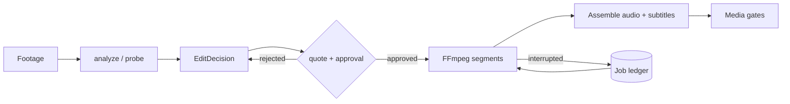

# Video Factory

## Plugin marketplaces

This plugin belongs to **AIGC content creation**.

| Category | Marketplace | Purpose |
| --- | --- | --- |
| Full-stack development | [Full Stack Plugins](https://github.com/partme-ai/full-stack-plugins) | Architecture and UI design, code understanding, quality checks, code review, workflow governance, and server operations |
| AIGC content creation | [Full AIGC Plugins](https://github.com/partme-ai/full-aigc-plugins) | Image, video, audio, music, 3D, and multimodal content creation |


> Analyze shots, plan an edit, approve it by hash, render locally with FFmpeg, and hand back a receipt for every output file — no cloud service and no API key.

[](https://github.com/full-aigc-plugins/video-factory-plugin/releases)
[](#installation)
[](#skills)
[](LICENSE)

[English](README.md) | [简体中文](README.zh-CN.md) · [Install](#installation) · [Quick start](#quick-start) · [Skills](#skills) · [Troubleshooting](#troubleshooting)

## Positioning

`video-factory` turns existing footage into an approved, verifiable edit. The host agent analyzes shots, proposes a closed `EditDecision`, quotes the stage, waits for your approval, renders through local FFmpeg, and records media receipts for every output.

The repository keeps the canonical `video` spelling across repository, plugin, package, CLI, and skill identifiers. There is no cloud service, no API key, and no vendor upload.

| Property | Value |
| --- | --- |
| Plugin ID | `video-factory` |
| Version | `0.5.1+codex.20261018` |
| Maturity | Local composition is stable; the recorded runtime acceptance covers the `0.1.0` line |
| Runtime | Node.js 18+, FFmpeg and ffprobe on `PATH` |
| MCP server | None; the plugin exposes a skill-driven CLI instead |

The `0.5.0` line has no fresh runtime acceptance record in this repository. Treat recorded media evidence as line-specific and re-verify before claiming a release.

## Installation

### Prerequisites

- Node.js 18 or newer on `PATH`.
- FFmpeg and ffprobe on `PATH`; required for every probe and render.
- Chrome or Chromium only for the enhanced synchronized review video.
- Your footage as local regular files beneath `--input-root`; the plugin never fetches a URL.

### From the plugin marketplace

```bash
codex plugin marketplace add partme-ai/full-aigc-plugins
codex plugin add video-factory@full-aigc-plugins
```

### From the repository-local marketplace

```bash
codex plugin marketplace add full-aigc-plugins/video-factory-plugin --ref v0.5.1
codex plugin add video-factory@partme-ai-video-factory
```

Restart Codex or the ChatGPT desktop app and open a new task so the skills load. There is no build step and no `npm install`: the CLI has zero runtime dependencies.

For development, clone the repository and run `bin/video-factory probe`; it reports Node, FFmpeg, and ffprobe availability plus whether the enhanced review path is usable. `codex plugin list` should show `video-factory@partme-ai-video-factory  installed, enabled`.

## Quick start

1. Probe the footage, then let the host annotate the shot analysis. Finalize it with the measured track and keyframes:

```bash
bin/video-factory analyze source.mp4 --out reelbench-analysis
bin/video-factory analyze-finalize reelbench-analysis/shots.json \
  --track reelbench-analysis/track.json --frames reelbench-analysis/frames
```

2. Validate the edit decision, quote the rough cut, and approve that exact revision:

```bash
bin/video-factory validate-plan video-plan.json
bin/video-factory quote video-plan.json --stage rough
bin/video-factory run video-plan.json --stage rough --approval rough-approval.json
```

3. Build the synchronized review, quote and approve the final cut, then record your acceptance:

```bash
bin/video-factory review-sync output/rough.mp4 reelbench-analysis/shots.json
bin/video-factory quote video-plan.json --stage final
bin/video-factory run video-plan.json --stage final --approval final-approval.json
bin/video-factory accept final-job.json --decision approved --note "played and accepted"
```

An approval binds the stage, plan hash, edit hash, round, and quote revision. Any change to an asset, an edit, or an output specification invalidates the old approval. The rough cut and the final cut are approved separately, and a rejected stage returns to planning.

## What you can build

| Workflow | Built-in path | Verifiable output |
| --- | --- | --- |
| Break footage into shots | `analyze`, `analyze-finalize`, `video-shots` | `shots.json`, track, keyframes, and a shot report |
| Assemble a rough cut | `validate-plan` → `quote` → `run` | Resumable H.264/AAC MP4 with per-segment receipts |
| Review picture against shot data | `review-sync` | Internal review MP4 with synchronized shot data |
| Finish with audio, subtitles, and titles | final stage `run` | Multi-track final MP4 plus embedded subtitle track |
| Judge and accept | `evaluate`, `accept` | Three-state media gates and a recorded human decision |
| Resume an interrupted render | `recover` | Pending segments resumed without re-rendering completed ones |
| Slice a talking-head recording | `episode-slice`, `episode-roughcut` | Rough-cut MP4, aligned SRT, and `cutlist.json` |

## Skills

| Skill | Purpose |
| --- | --- |
| `video-factory-use` | Routes an editing request to the correct workflow |
| `video-factory-plan` | Converts local assets and shot evidence into a validated `EditDecision` |
| `video-factory-run` | Renders an approved stage and records receipts without automatic retry |
| `video-factory-judge` | Runs media gates, advisory semantic review, and human acceptance or rework labels |
| `video-factory-recover` | Reads the durable ledger and determines the only legal next action |
| `video-factory-harness` | Calling spec for the CLI surface and the rough → review → final approval gate |
| `video-episode-slicing` | Word-level ASR timeline → cut points → rough cut, SRT, and cutlist |
| `video-shots` | Vendored ReelBench shot breakdown with deterministic evidence |
| `video-sync` | Vendored annotated review video that pairs picture with shot data |

The `video-factory-use/plan/run/judge/recover` skills are vendored from `video-factory-skills v1.0.2` through `skills.lock.json`. `video-shots` and `video-sync` are ReelBench snapshots pinned by Git blob and SHA-256 in `upstream/reelbench.lock.json`; `video-episode-slicing` and `video-factory-harness` are plugin-local. Edit none of these copies in place.

## Slash commands

| Command | What it does |
| --- | --- |
| `/video-factory` | Total entry point; routes by capability |
| `/video-factory-plan` | Builds the timeline and edit decision |
| `/video-factory-run` | Renders the approved edit and collects receipts |
| `/video-factory-judge` | Reviews finished media and records the verdict |
| `/video-factory-recover` | Resumes an interrupted composition job |
| `/video-episode` | Slices and rough-cuts a talking-head recording |

## Configuration

| Setting | Where it lives | Notes |
| --- | --- | --- |
| Job ledger | `<plan>.job.json`, or the `--ledger` path | Plain JSON with atomic per-segment updates |
| Input root | `--input-root` | Only regular files beneath it are accepted |
| Render outputs | The output directory you choose | Never overwritten silently |
| Review assets | The analysis directory | Keyframes and contact sheets stay local |
| Credentials | None | The runtime never reads an API key or token |

## Architecture and security



| Component | Owns | Does not own |
| --- | --- | --- |
| `src/cli.mjs` | Command dispatch, exit codes, argument validation | Media processing |
| `src/orchestrator.mjs` | Run, approve, and recover sequencing | FFmpeg argv construction |
| `src/ffmpeg-compiler.mjs` | Deterministic argv and content-addressed segment keys | Approval decisions |
| `src/job-ledger.mjs`, `src/approval.mjs` | Durable state, resume points, hash-bound approvals | Cost estimation |
| `skills/` (9) | Routing, planning, review, and recovery instructions | Runtime behaviour |

The plugin makes no network call for generation; local FFmpeg is the only execution engine. Approvals are single-use and bound to content hashes, so they cannot be replayed against different content. Input containment rejects paths outside `--input-root`, path traversal, symlink escapes, special files, arbitrary FFmpeg filter graphs, and credential fields. All child processes run with `shell: false`.

## Troubleshooting

| Symptom | Check first | Resolution |
| --- | --- | --- |
| `probe` reports a missing tool | FFmpeg and ffprobe on `PATH` | Install FFmpeg and re-run `probe` |
| Plan validation fails | `EditDecision` schema | Fix the named field; unknown fields are rejected |
| Run refuses to start | The approval file | Re-quote the stage and approve the new revision |
| Render stops mid-way | Ledger state | Run `recover`; completed segments are never re-rendered |
| Review video is unavailable | Chrome presence | Install Chrome, or skip the enhanced review |
| Subtitle burn-in is missing | The local FFmpeg build | The verified FFmpeg 9.0.1 lacks libass; the step is recorded as `SKIPPED` |
| Semantic consistency is unproven | Gate status | It stays `NOT_RUN`; Codex or a human reviews it |
| Verification is missing for your platform | Recorded evidence | Media acceptance was recorded on macOS; re-verify on your platform |
| A remote generation path was expected | Plugin scope | Native video generation is blocked by design |

## Upgrade

```bash
codex plugin marketplace upgrade partme-ai-video-factory
codex plugin add video-factory@partme-ai-video-factory
```

## Contributing and support

Open functional issues at <https://github.com/full-aigc-plugins/video-factory-plugin/issues>. Before proposing a change, state the target Node version and whether it alters the approval binding or the ledger format, and include the affected tests.

## License

Apache-2.0 — see [LICENSE](LICENSE) and [THIRD_PARTY_NOTICES.md](THIRD_PARTY_NOTICES.md). Vendored ReelBench skills keep their upstream terms.
