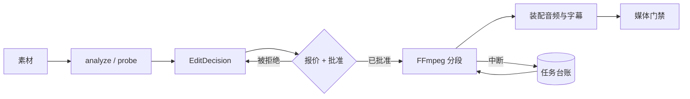

# Video Factory

## 插件市场导航

本插件所属分类：**AIGC 内容创作**。

| 分类 | 插件市场入口 | 用途 |
| --- | --- | --- |
| 全栈开发 | [Full Stack Plugins](https://github.com/partme-ai/full-stack-plugins) | 架构与 UI 设计、代码理解、质量检查、代码审查、流程治理与服务器运维 |
| AIGC 内容创作 | [Full AIGC Plugins](https://github.com/partme-ai/full-aigc-plugins) | 图像、视频、音频、音乐、3D 与多模态内容创作 |


> 拆镜头、定剪辑、按哈希批准、在本机用 FFmpeg 渲染，并为每个输出文件留下媒体回执——没有云端服务，也不需要 API Key。

[](https://github.com/full-aigc-plugins/video-factory-plugin/releases)
[](#安装)
[](#技能)
[](LICENSE)

[English](README.md) | [简体中文](README.zh-CN.md) · [安装](#安装) · [快速开始](#快速开始) · [技能](#技能) · [故障排查](#故障排查)

## 项目定位

`video-factory` 把已有素材变成一次经过批准、可以核验的剪辑。宿主智能体先分析镜头，提出封闭的 `EditDecision`，对当前阶段报价，等你批准后由本机 FFmpeg 渲染，并为每个输出写入媒体回执。

仓库、插件、包、CLI 与技能标识统一使用 `video` 这一拼写。全程没有云端服务、没有 API Key，也不向第三方上传素材。

| 项目 | 值 |
| --- | --- |
| 插件 ID | `video-factory` |
| 版本 | `0.5.1+codex.20261018` |
| 成熟度 | 本地合成稳定；仓库中已记录的真实运行验收对应 `0.1.0` 线 |
| 运行环境 | Node.js 18 及以上，`PATH` 上有 FFmpeg 与 ffprobe |
| MCP 服务器 | 无；插件提供的是由技能驱动的 CLI |

`0.5.0` 线在本仓库尚无新的真实运行验收记录。已记录的媒体证据只对对应版本成立，对外宣称发布前必须重新验证。

## 安装

### 前置条件

- `PATH` 上有 Node.js 18 或更新版本。
- `PATH` 上有 FFmpeg 与 ffprobe；每次探测和渲染都需要。
- 只有增强版同步审阅视频需要 Chrome 或 Chromium。
- 素材必须是 `--input-root` 下的本地普通文件；插件不会抓取 URL。

### 从插件市场安装

```bash
codex plugin marketplace add partme-ai/full-aigc-plugins
codex plugin add video-factory@full-aigc-plugins
```

### 从仓库内置市场安装

```bash
codex plugin marketplace add full-aigc-plugins/video-factory-plugin --ref v0.5.1
codex plugin add video-factory@partme-ai-video-factory
```

重启 Codex 或 ChatGPT 桌面应用，新建任务以加载技能。项目没有构建步骤，也不需要 `npm install`：CLI 没有任何运行时依赖。

二次开发可直接克隆仓库并执行 `bin/video-factory probe`；它会报告 Node、FFmpeg、ffprobe 是否可用，以及增强审阅路径能否使用。`codex plugin list` 应显示 `video-factory@partme-ai-video-factory  installed, enabled`。

## 快速开始

1. 先探测素材，再由宿主标注镜头分析，最后用实测轨道与关键帧定稿：

```bash
bin/video-factory analyze source.mp4 --out reelbench-analysis
bin/video-factory analyze-finalize reelbench-analysis/shots.json \
  --track reelbench-analysis/track.json --frames reelbench-analysis/frames
```

2. 校验剪辑决策，对粗剪报价，并批准这一确切 revision：

```bash
bin/video-factory validate-plan video-plan.json
bin/video-factory quote video-plan.json --stage rough
bin/video-factory run video-plan.json --stage rough --approval rough-approval.json
```

3. 生成同步审阅，对终版报价并批准，然后记录人工验收：

```bash
bin/video-factory review-sync output/rough.mp4 reelbench-analysis/shots.json
bin/video-factory quote video-plan.json --stage final
bin/video-factory run video-plan.json --stage final --approval final-approval.json
bin/video-factory accept final-job.json --decision approved --note "played and accepted"
```

批准会绑定阶段、计划哈希、剪辑哈希、轮次与报价 revision。素材、剪辑或输出规格任一变化都会让旧批准失效。粗剪与终版分别批准，被拒绝的阶段回到计划环节。

## 可完成的工作

| 工作流 | 内置路径 | 可验证输出 |
| --- | --- | --- |
| 把成片拆成镜头 | `analyze`、`analyze-finalize`、`video-shots` | `shots.json`、轨道、关键帧与镜头报告 |
| 装配粗剪 | `validate-plan` → `quote` → `run` | 可续跑的 H.264/AAC MP4 与逐段回执 |
| 画面与分镜数据对照审阅 | `review-sync` | 带同步分镜数据的内部审阅 MP4 |
| 完成音频、字幕与标题 | 终版阶段 `run` | 多轨终版 MP4 与内嵌字幕轨 |
| 评审与验收 | `evaluate`、`accept` | 三态媒体门禁与人工决策记录 |
| 恢复中断的渲染 | `recover` | 只续跑 Pending 分段，不重渲已完成分段 |
| 口播切片精剪 | `episode-slice`、`episode-roughcut` | 粗剪 MP4、对齐 SRT 与 `cutlist.json` |

## 技能

| 技能 | 作用 |
| --- | --- |
| `video-factory-use` | 把剪辑请求路由到正确的工作流 |
| `video-factory-plan` | 把本地素材与镜头证据转成已校验的 `EditDecision` |
| `video-factory-run` | 渲染已批准阶段并记录回执，不做自动重试 |
| `video-factory-judge` | 运行媒体门禁、参考性语义评审与人工验收或返工标注 |
| `video-factory-recover` | 读取持久台账，判定唯一合法下一步 |
| `video-factory-harness` | CLI 调用规范与粗剪 → 人工审阅 → 终版批准门禁 |
| `video-episode-slicing` | 词级 ASR 时间轴 → 切点 → 粗剪、SRT 与切点清单 |
| `video-shots` | vendor 的 ReelBench 拉片与确定性镜头证据 |
| `video-sync` | vendor 的分镜对照审阅视频，画面与镜头数据同步 |

`video-factory-use/plan/run/judge/recover` 五个技能经 `skills.lock.json` vendor 自 `video-factory-skills v1.0.2`。`video-shots` 与 `video-sync` 是 ReelBench 快照，由 `upstream/reelbench.lock.json` 固定 Git blob 与 SHA-256；`video-episode-slicing` 与 `video-factory-harness` 为插件自有。以上副本都不要就地修改。

## 斜杠命令

| 命令 | 作用 |
| --- | --- |
| `/video-factory` | 总入口，按能力路由 |
| `/video-factory-plan` | 制定时间线与剪辑决策 |
| `/video-factory-run` | 渲染已批准的剪辑并采集回执 |
| `/video-factory-judge` | 审阅成片并记录结论 |
| `/video-factory-recover` | 恢复中断的装配作业 |
| `/video-episode` | 口播素材切片与粗剪 |

## 配置

| 设置 | 所在位置 | 说明 |
| --- | --- | --- |
| 任务台账 | `<plan>.job.json`，或 `--ledger` 路径 | 纯 JSON，逐分段原子更新 |
| 输入根目录 | `--input-root` | 只接受其下的普通文件 |
| 渲染输出 | 你选择的输出目录 | 不会静默覆盖 |
| 审阅资产 | 分析目录 | 关键帧与联系表保留在本机 |
| 凭据 | 无 | 运行时从不读取 API Key 或 Token |

## 架构与安全



| 组件 | 负责 | 不负责 |
| --- | --- | --- |
| `src/cli.mjs` | 命令分发、退出码、参数校验 | 媒体处理 |
| `src/orchestrator.mjs` | 运行、批准与恢复的时序 | FFmpeg argv 构造 |
| `src/ffmpeg-compiler.mjs` | 确定性 argv 与内容寻址的分段键 | 批准决策 |
| `src/job-ledger.mjs`、`src/approval.mjs` | 持久状态、续跑点、哈希绑定批准 | 成本估算 |
| `skills/`（9 个） | 路由、计划、审阅与恢复指令 | 运行时行为 |

插件不为生成发起任何网络请求，本机 FFmpeg 是唯一执行引擎。批准一次性使用并绑定内容哈希，不能挪用到别的内容上。输入约束会拒绝 `--input-root` 之外的路径、路径穿越、符号链接逃逸、特殊文件、任意 FFmpeg filter graph 与凭据字段；所有子进程均以 `shell: false` 运行。

## 故障排查

| 现象 | 优先检查 | 处理方式 |
| --- | --- | --- |
| `probe` 报告工具缺失 | `PATH` 上的 FFmpeg 与 ffprobe | 安装 FFmpeg 后重跑 `probe` |
| 计划校验失败 | `EditDecision` schema | 修正被点名的字段；未知字段会被拒绝 |
| 运行拒绝启动 | 批准文件 | 重新对该阶段报价并批准新 revision |
| 渲染中途停止 | 台账状态 | 执行 `recover`；已完成分段不会重渲 |
| 审阅视频不可用 | 是否装有 Chrome | 安装 Chrome，或跳过增强审阅 |
| 字幕没有烧录 | 本机 FFmpeg 构建 | 已验证的 FFmpeg 9.0.1 缺少 libass，该步骤记为 `SKIPPED` |
| 语义一致性无法证明 | 门禁状态 | 保持 `NOT_RUN`，交由 Codex 或人工审片 |
| 当前平台缺少验收记录 | 已记录证据 | 媒体验收在 macOS 上完成；换平台需重新验证 |
| 期望远程生成路径 | 插件范围 | 原生视频生成按设计封锁 |

## 升级

```bash
codex plugin marketplace upgrade partme-ai-video-factory
codex plugin add video-factory@partme-ai-video-factory
```

## 贡献与支持

功能问题请提交到 <https://github.com/full-aigc-plugins/video-factory-plugin/issues>。提交变更前，请说明目标 Node 版本、是否改动批准绑定或台账格式，并附上受影响的测试。

## 许可证

Apache-2.0，见 [LICENSE](LICENSE) 与 [THIRD_PARTY_NOTICES.md](THIRD_PARTY_NOTICES.md)。vendor 的 ReelBench 技能保留其上游条款。
